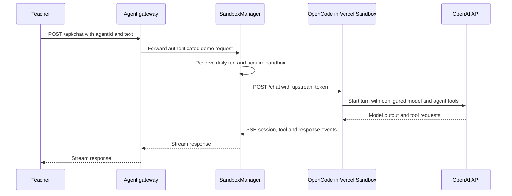

# School backend and AI architecture

For cloud placement, data ownership and release paths across both Workers, see the [backend cloud architecture](CLOUD-ARCHITECTURE.md).

## Current implementation

Crudex has two Cloudflare Workers. The Hono application in [apps/api](../apps/api/src/app.ts) owns the school API integration work. The separate agent gateway introduced in PR #2 already runs a teacher-assistant demo. Its chat and status endpoints are `GET /api/status`, `GET /api/agents` and `POST /api/chat`. The gateway verifies a passcode session and routes chat through the sandbox manager named `main`. The daily chat cap applies to that manager. [Gateway entry](../apps/agent-gateway/src/index.ts) · [Sandbox manager](../apps/agent-gateway/src/sandbox-manager.ts)

PR #4 adds teacher/principal role selection and a second Durable Object, `MorningBrief` (binding `BRIEFS`, instance `principal`). After the first brief request it schedules a daily alarm for 07:00 Bangkok. `GET /api/brief` reads the latest stored brief and next alarm. `POST /api/brief/run` requests a manual run. Both manual and scheduled generation call the sandbox manager as principal, validate the completed stream, and store the latest accepted result. The passcode is shared and the role query selects a demo view. [Gateway contract](agent-gateway.md) · [Brief handler](../apps/agent-gateway/src/morning-brief.ts)

**Integration blocker at `1724d2b`.** The runtime selects principal agents named `rungchao` and `lekha_por`, but neither appears in the registry. The resulting principal agent list is empty; the brief’s call to `rungchao` receives `unknown_agent`, so manual generation returns HTTP 502 on this code path. These outcomes follow from source inspection. [Runtime role filter](../apps/agent-runtime/src/server.ts) · [Agent registry](../apps/agent-runtime/src/agents/index.ts)

The manager handles concurrent startup, downloads the runtime bundle with a single-use boot token, checks readiness, drains active requests before rotation and stops idle sandboxes. It starts Node 24 in a nonpersistent Vercel Sandbox and supplies the upstream token and server-side OpenAI key. The runtime opens its local OpenCode SQLite database, registers the plugin and accepts authenticated chat requests. A matching warm session can continue. A replacement starts fresh. [Launcher](../apps/agent-gateway/src/sandbox.ts) · [Harness](../apps/agent-runtime/src/harness.ts) · [HTTP server](../apps/agent-runtime/src/server.ts)

The secretary (`jaew`) delegates to `jum` for worksheets and exams, `jeng` for teaching media, `porn` for administration, and `nun` for student insights. Each has its own tools and instructions. The runtime creates OpenAI sessions with the agent’s configured model, currently `gpt-5.4-mini`, and streams parent and delegated work. The turn has a 120-second deadline. Closing the runtime response interrupts an unfinished turn. [Agent definitions](../apps/agent-runtime/src/agents) · [Turn runner](../apps/agent-runtime/src/run.ts)

## School-account integration target

Keep the existing runtime, plugin, tool permissions and sandbox launcher. Introduce a trusted service-to-service path from the Hono API to the agent gateway. Preserve the existing passcode routes for synthetic demos. Before real school data is available, enforce the following boundaries.

| Boundary | Required change |
| --- | --- |
| Client → school API | Authenticate the actor and resolve their school, class assignments and roles from memberships. Accept a client request ID. Return a durable run ID. |
| School API → agent gateway | Dispatch through an authenticated internal route. Derive manager identity from verified school and owner IDs. Keep the existing overall capacity ceiling when introducing owner-specific quota and sandboxes. |
| Gateway → runtime | Bind school, owner, class, agent, run, attempt and expiry to a verifiable credential. Resolve warm session IDs server-side. Use the existing upstream token for transport authentication. |
| Runtime → school API | Require scoped tool callbacks. Routes validate input, services enforce membership and repositories read or write Neon. An invocation ID deduplicates tool effects. An expired or superseded attempt cannot commit results. |

For a worksheet request, the API stores the run and dispatch intent together. A queue consumer claims it and consumes the existing gateway SSE stream independently of the browser. It persists ordered events and terminal status. The client reads these through the school API and can reconnect using its last event ID. The existing assessment checker validates the questions; the school service validates the save and stores one immutable artifact version for both the secretary and worksheet histories. A browser disconnect only ends the client subscription in this proposed flow.

## Data ownership and failure behavior

| Data | Today | School integration target |
| --- | --- | --- |
| Session and scratch files | Temporary sandbox database and filesystem | Same lifetime. Start a fresh session after replacement. |
| Usage and lifecycle | Durable Object storage for the shared manager | Retain lifecycle management; reserve school/owner usage once per logical request. |
| Scores and memory | Sample scores and process-local memory with a sample identity fallback | School-scoped repositories for grades and approved memories. Require an authenticated approval receipt for each memory write. |
| Runs, worksheets and reports | Direct chat stream and tool-specific results | Persist business records in Neon. Use an outbox for scheduled delivery and track draft, confirmed and uncertain outcomes. |

On sandbox loss, mark the active attempt interrupted. Completed artifacts remain readable. An explicit retry starts a new run. After uncertain dispatch or external delivery, reconcile the recorded outcome before issuing another paid turn or sending another report. Logs carry IDs, timings, usage and outcome codes. Keep keys, prompts and student records out of logs.

The [product contracts](PRODUCT.md) define the backend workflows. The [implementation plan](../PLAN.md) sequences the remaining work and its acceptance checks.
