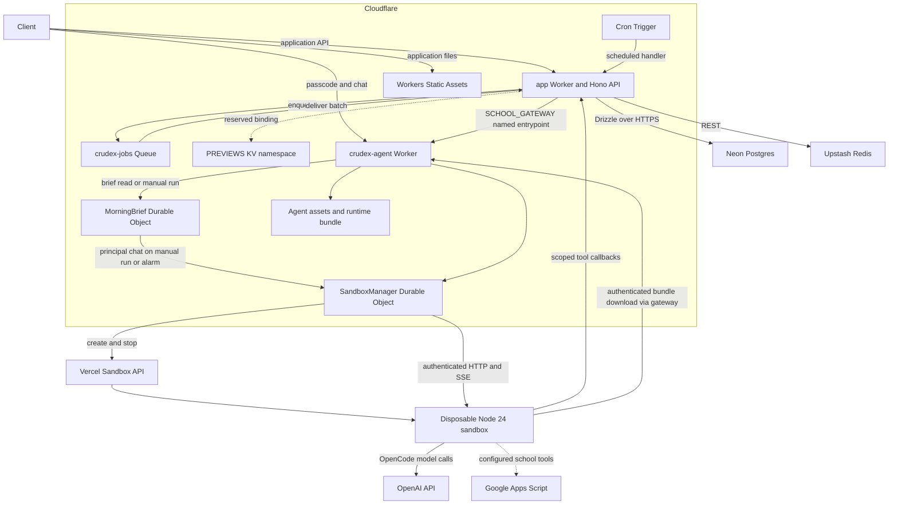

# Crudex backend on cloud services

Crudex has two independently deployed Cloudflare Workers. **`app`** serves the application and owns the database, cache and background jobs. **`crudex-agent`** runs OpenCode on Vercel Sandbox for authenticated school runs and the separate passcode demo. The application Worker owns school identity and dispatches AI work over a private service binding.

## Current deployment topology

Solid arrows show configured runtime paths. Dotted arrows indicate an optional integration or a binding reserved for future use.

## Component placement and ownership

| Component | Cloud service and implementation | Responsibility and state |
| --- | --- | --- |
| Public application | Cloudflare Worker `app` and Workers Static Assets | Serves the SPA on the same origin. Requests under `/api/*` run Hono. Routes cover identity, runs, memory, grades, reports, briefs, approvals, health and notes. |
| School API layers | Hono routes, services and repositories inside `app` | Shared Zod schemas define wire contracts. Routes validate input, services implement business rules and repositories use Drizzle. These layers ship together. |
| Primary database | Neon serverless Postgres | Authoritative store for notes, memberships, runs, approved memory, assessment versions, grades and delivery records. Access goes through the API repositories. |
| Cache | Upstash Redis over REST | The Worker initializes its client lazily. The scheduled keepalive writes to Redis. A cache outage need not invalidate durable records in Neon. |
| Async delivery | Cloudflare Queue `crudex-jobs`, bound as `JOBS_QUEUE` | The app Worker produces and consumes messages. The consumer processes run dispatches, report drafts, pings and note events one message per batch. Run and report jobs deduplicate effects in Postgres. |
| Scheduler | Cloudflare Cron Triggers invoking `app.scheduled` | A daily 03:17 UTC trigger keeps Redis active. A five-minute trigger recovers runs and finds due Bangkok-local routines. |
| Preview storage | Cloudflare Workers KV, binding `PREVIEWS` | Terraform provisions the namespace. The intended use is short-lived generated files; the current API has no preview writer or download route. Implement expiration on writes and authorize reads before using this for school artifacts. |
| Agent gateway and assets | Cloudflare Worker `crudex-agent`, its own Workers Static Assets binding | Checks the demo passcode session, exposes status, agent list and chat, and serves the runtime archive through a one-use boot credential. Streams responses to the caller. |
| Sandbox coordinator | SQLite-backed Cloudflare Durable Object `SandboxManager`, binding `SANDBOX` | The current singleton `main` holds sandbox lifecycle metadata and daily usage. It serializes startup, drains streams on rotation and uses alarms for idle cleanup. |
| Morning brief | Cloudflare Durable Object `MorningBrief`, binding `BRIEFS` | Saves the latest validated demo brief and manages its own 07:00 Bangkok alarm. Generation calls the registered `rungchao` agent. [Brief contract](agent-gateway.md) |
| AI execution | Vercel project and ephemeral Vercel Sandbox | The project scopes sandbox creation. The sandbox runs the Node 24 HTTP server, OpenCode plugin, teacher agents and school tools. Its local SQLite session database and scratch files expire with it. The next turn may start fresh. |
| Model inference | OpenAI API | The runtime selects the model and sends the prompt and permitted tool descriptions. Tool execution happens in the backend. The gateway injects the OpenAI key into the runtime process. |
| External school actions | Optional Google Apps Script endpoint | Configured adapters can publish Forms or request email delivery. School worksheets use the local quiz API. School routines currently create report drafts. |

Application details are defined in the [Worker configuration](../apps/api/wrangler.toml), [HTTP entry](../apps/api/src/app.ts), [queue consumer](../apps/api/src/jobs/queue-handler.ts) and [scheduler](../apps/api/src/jobs/scheduled-handler.ts). Agent boundaries are defined in the [gateway configuration](../apps/agent-gateway/wrangler.toml), [sandbox manager](../apps/agent-gateway/src/sandbox-manager.ts) and [runtime](../apps/agent-runtime/src/server.ts).

## Contracts across services

The [school request lifecycle](ARCHITECTURE.md) follows a run through the queue, gateway and sandbox. The [API specification](openapi.yaml) defines client operations and runtime callbacks. The [database reference](DATABASE.md) lists the keys that enforce uniqueness for runs, tool effects, submissions and notifications.

## Provisioning, release and operations

| Service | Ownership |
| --- | --- |
| Terraform and HCP Terraform | The production root declares Neon, Upstash, Queue, KV and the Vercel project. HCP holds Terraform state. Product records belong in the application stores. [Terraform root](../infra/envs/prod/main.tf) |
| GitHub Actions, application release | CI builds the SPA, resolves Terraform outputs for bindings and secrets, runs backward-compatible Drizzle migrations, then deploys the Worker and assets. [Application release](../.github/workflows/deploy.yml) |
| GitHub Actions, agent release | After an agent PR merges into `main`, or on manual dispatch, a separate workflow bundles the runtime archive, resolves cloud identifiers, deploys the gateway with its runtime revision and invokes the smoke test. It prefers the Vercel project named `crudex` and falls back to another returned project if absent. Confirm the resolved project when tracing a deployment. [Agent release](../.github/workflows/deploy-agent.yml) |
| Credentials and observability | CI supplies encrypted Worker secrets. The application receives database and Redis access; the agent gateway receives provisioning credentials and injects runtime credentials at launch. The application Worker enables Cloudflare observability. Use request, run and attempt IDs for cross-service diagnosis as school workflows are added. [Infrastructure guide](../infra/README.md) |

This is a repository-level architecture. Live resource health, free-tier headroom and account eligibility are environment checks before hosted rollout.
