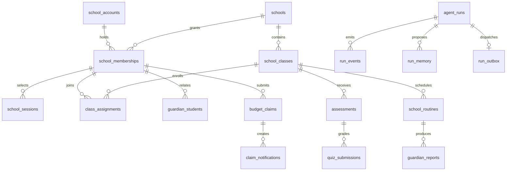

# School database schema

Neon Postgres owns school identities, runs, saved work, grades and reporting records. Drizzle uses the Neon HTTP driver in the Worker. Local development uses Postgres through a Neon-compatible proxy. The agent sandbox has a separate disposable SQLite database for OpenCode sessions. The gateway’s Durable Objects store demo state and sandbox lifecycle metadata. Those stores contain no canonical school grades or membership records.

## Read the relationships

A school account identifies a person. A membership gives that account a role in one school. An account can have multiple memberships; a school session selects one. A class assignment connects a teacher or student membership to a class. A guardian relationship connects two memberships in the same school. `owner_id` refers to the account, while `teacher_id`, `student_id`, `guardian_id` and `decided_by` in school business tables refer to memberships.

## Data dictionary

The tables below match the Drizzle migration snapshot. A question mark means nullable. Primary keys, foreign keys and unique constraints are listed explicitly. Some associations, such as the run ID saved with a worksheet, are checked at the service boundary. See the [schema definitions](../apps/api/src/db/schema) and [versioned SQL migrations](../apps/api/drizzle).

### Identity and school scope

**`schools`** — Tenant boundary.

`id` uuid, `name` text.

PK (id).

**`school_accounts`** — Stable account identity.

`id` uuid, `display_name` text.

PK (id).

**`school_memberships`** — School role with optional expiry.

`id` uuid, `school_id` uuid, `owner_id` uuid, `role` school_role, `expires_at` timestamptz?.

PK (id) · Unique (school_id, id) · Unique (school_id, owner_id, role) · school_id → schools(id) · owner_id → school_accounts(id).

**`school_classes`** — Named class owned by a school.

`id` uuid, `school_id` uuid, `name` text.

PK (id) · Unique (school_id, id) · school_id → schools(id).

**`class_assignments`** — Class access for an assigned staff member or student.

`school_id` uuid, `membership_id` uuid, `class_id` uuid.

PK (membership_id, class_id) · school_id, membership_id → school_memberships(school_id, id) · school_id, class_id → school_classes(school_id, id).

**`guardian_students`** — Current per-child access for a guardian.

`school_id` uuid, `guardian_membership_id` uuid, `student_membership_id` uuid.

PK (guardian_membership_id, student_membership_id) · school_id, guardian_membership_id → school_memberships(school_id, id) · school_id, student_membership_id → school_memberships(school_id, id).

**`school_invitations`** — Hashed, expiring single-use sign-in credential.

`digest` text, `membership_id` uuid, `expires_at` timestamptz.

PK (digest) · membership_id → school_memberships(id).

**`school_sessions`** — Hashed session token and selected membership.

`digest` text, `membership_id` uuid, `expires_at` timestamptz.

PK (digest) · membership_id → school_memberships(id).

### Agent execution

**`agent_runs`** — Logical user request, accepted role and current execution lease.

`id` uuid, `school_id` uuid, `owner_id` uuid, `membership_id` uuid, `role` text, `agent_id` text, `class_id` uuid?, `request_id` uuid, `prompt` text, `status` text, `attempt_id` uuid?, `credential_hash` text?, `lease_until` timestamptz?, `created_at` timestamptz.

PK (id) · Unique (school_id, owner_id, request_id) · Index (school_id, owner_id, agent_id, created_at).

**`run_outbox`** — Durable dispatch intent consumed when a run is claimed.

`run_id` uuid.

PK (run_id) · run_id → agent_runs(id).

**`run_events`** — Committed JSON events ordered by serial cursor. Gaps in IDs across runs are normal.

`id` serial, `run_id` uuid, `body` jsonb.

PK (id) · Index (run_id, id) · run_id → agent_runs(id).

**`run_quota`** — Global reservations by Bangkok calendar day.

`day` date, `used` integer.

PK (day) · Check `"run_quota"."used" <= 60`.

**`owner_run_quota`** — Per-account reservations for the same day.

`day` date, `owner_id` uuid, `used` integer.

Unique (day, owner_id) · Check `"owner_run_quota"."used"<=20`.

**`run_memory`** — Pending proposal until approved_at is set; retrieval is school- and owner-scoped.

`id` uuid, `school_id` uuid, `owner_id` uuid, `run_id` uuid, `text` text, `approved_at` timestamptz?.

PK (id) · Unique (run_id, text) · Index (school_id, owner_id) · run_id → agent_runs(id).

### Classroom and family reporting

**`assessments`** — Immutable worksheet content, question and option ordering, verified key and play token.

`id` uuid, `play_token` uuid, `school_id` uuid, `class_id` uuid, `run_id` uuid, `invocation_id` text, `content` jsonb, `created_at` timestamptz.

PK (id) · Unique (play_token) · Unique (run_id, invocation_id) · Index (school_id, class_id) · school_id → schools(id) · school_id, class_id → school_classes(school_id, id).

**`quiz_submissions`** — One answer map and scored result for a student and assessment.

`id` uuid, `assessment_id` uuid, `student_id` uuid, `answers` jsonb, `score` integer, `max_score` integer, `created_at` timestamptz.

PK (id) · Unique (assessment_id, student_id) · assessment_id → assessments(id) · student_id → school_memberships(id).

**`school_routines`** — Teacher-owned daily report schedule with the next due instant.

`id` uuid, `school_id` uuid, `class_id` uuid, `teacher_id` uuid, `hour` integer, `minute` integer, `enabled` boolean, `next_run_at` timestamptz.

PK (id) · Unique (teacher_id, class_id, hour, minute) · Index (enabled, next_run_at) · teacher_id → school_memberships(id) · school_id, class_id → school_classes(school_id, id).

**`guardian_reports`** — A per-recipient report snapshot, initially a draft.

`id` uuid, `routine_id` uuid, `occurrence` timestamptz, `student_id` uuid, `guardian_id` uuid, `student_name` text, `subject` text, `body` text, `status` text, `created_at` timestamptz.

PK (id) · Unique (routine_id, occurrence, student_id, guardian_id) · routine_id → school_routines(id) · student_id → school_memberships(id) · guardian_id → school_memberships(id).

### Approval desk

**`budget_claims`** — Teacher request, immutable submitted line items and a principal decision.

`id` uuid, `school_id` uuid, `teacher_id` uuid, `client_request_id` uuid, `date` date, `budget_code` text, `purpose` text, `items` jsonb, `status` claim_status, `decided_by` uuid?, `reason` text?, `decided_at` timestamptz?, `submitted_at` timestamptz.

PK (id) · Unique (teacher_id, client_request_id) · Index (school_id, status, submitted_at) · Index (teacher_id, submitted_at) · school_id, teacher_id → school_memberships(school_id, id) · school_id, decided_by → school_memberships(school_id, id).

**`claim_notifications`** — One notification per decision channel.

`id` uuid, `claim_id` uuid, `channel` claim_channel.

PK (id) · Unique (claim_id, channel) · claim_id → budget_claims(id).

### Template records

**`notes`** — Existing example feature; independent of school identity.

`id` uuid, `title` text, `body` text?, `created_at` timestamptz.

PK (id) · Index (created_at).

## Transaction and retention behavior

- Sign-in deletes a valid invitation and creates the session in one statement. Only token digests are stored. Expiring or revoking membership prevents further access.
- Accepting a new run reserves both quotas, writes the initial event and inserts its dispatch intent together. A repeated client request ID resolves to the original run. The active attempt credential becomes unusable after expiry or a terminal transition.
- The worksheet key belongs in teacher-authorized responses only. Each student submission is tied to the saved worksheet and can be retried with the same answers. Business records survive sandbox replacement.
- Processing a due routine advances its next occurrence and inserts guardian drafts atomically. The occurrence and recipient uniqueness rule handles queue redelivery.
- A claim decision updates a pending claim and writes its notifications in a single SQL statement. Prices are integer satang. Claim items and submitted answers are JSONB because each is retained as one immutable submission.
- The schema currently has no automatic deletion policy for historical school records. Session and invitation expiry controls authorization; expiry alone does not physically purge rows.

For local schema changes, use `pnpm --filter api db:generate`, inspect the SQL and snapshot, then run `pnpm --filter api db:migrate` against a disposable local database. Production migrations must be additive while the prior Worker revision can still serve requests. [API contract](API.md)
