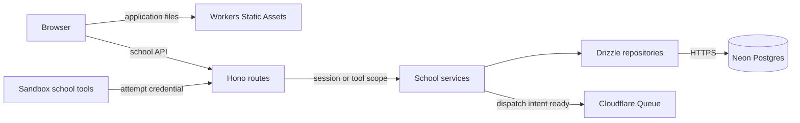
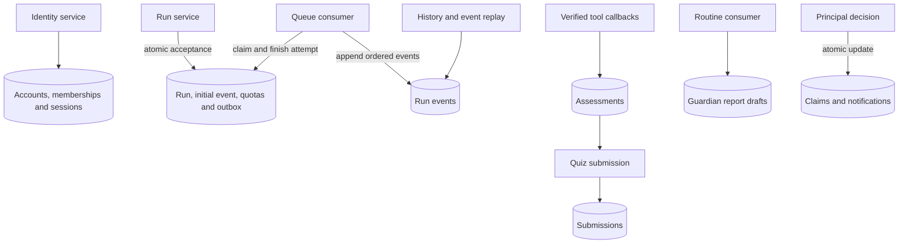
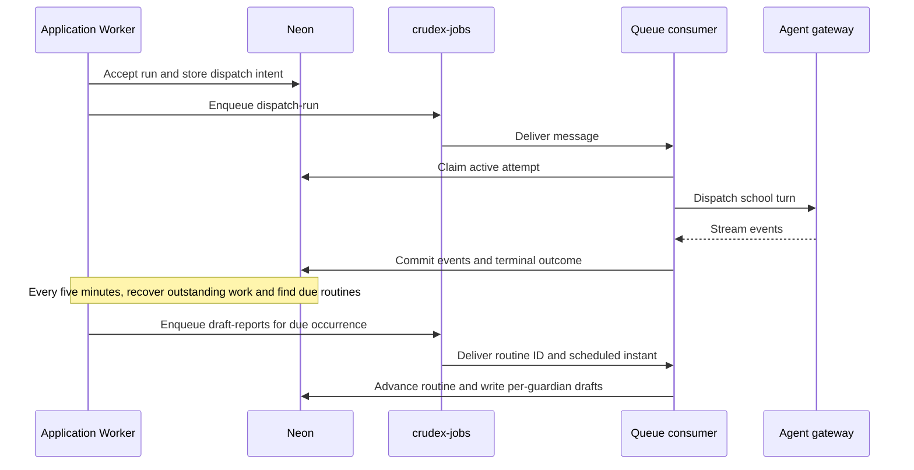
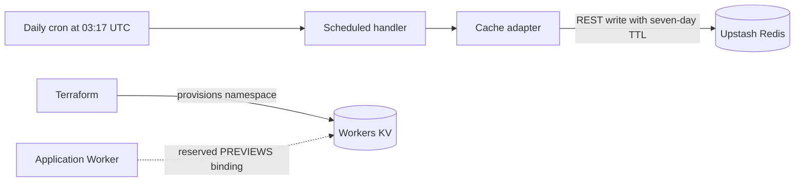
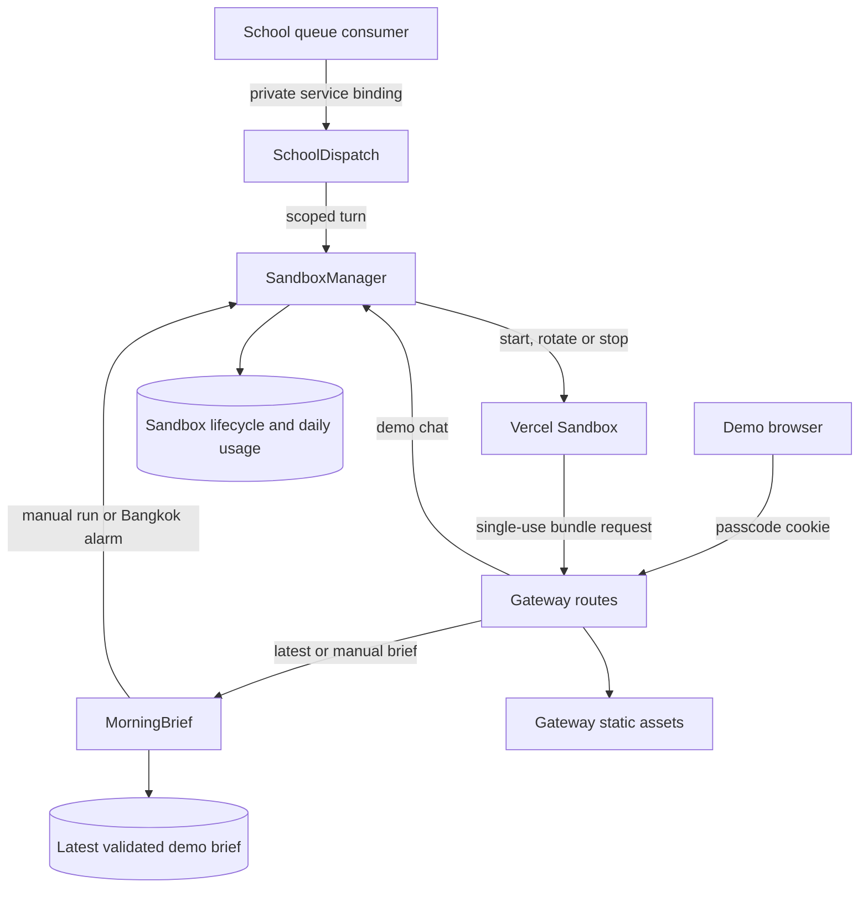
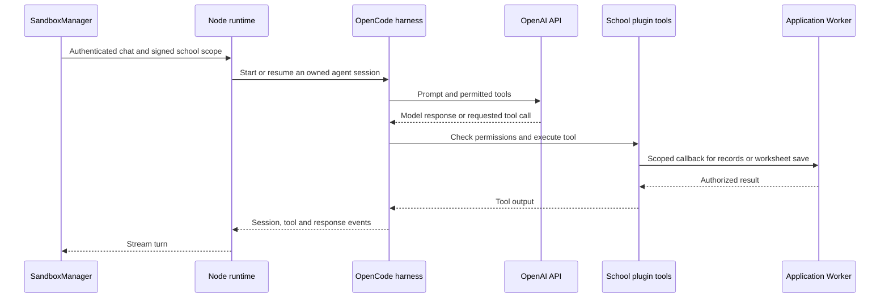
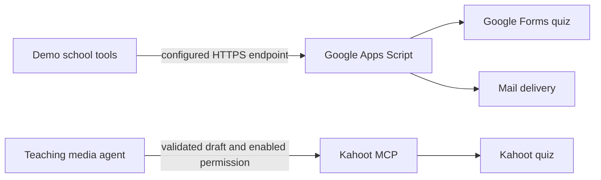
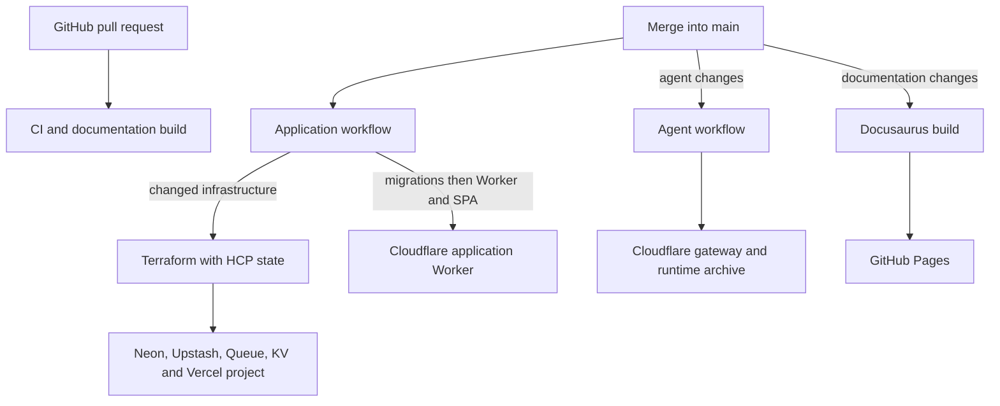

# Service architecture diagrams

Start with the [whole-system topology](cloud-services.md#current-deployment-topology) to see where services run. The diagrams below follow the same boundaries into each service. Arrows identify a request, write, event stream or scheduled invocation.

## Application Worker and static assets

Static assets serve the application. API routes validate inputs against shared contracts. Each school service checks the active membership or run scope before calling its repository. The [API explorer](../reference/openapi.mdx) lists both browser routes and internal callbacks.

## Neon Postgres

These are tables in one database. Daily quota reservations and dispatch intent commit with the new run. A repeated submission uses the saved worksheet and student identity to find the original grade. The [schema](../reference/database.md) lists the keys, constraints and ownership rules for every table.

## Cloudflare Queues and cron

The consumer handles one message per batch. It retries transient handler failures with backoff. Postgres tracks run attempts and deduplicates routine deliveries. A client reconnect reads committed events independently of queue delivery.

## Upstash Redis and Workers KV

The keepalive refreshes one Redis key. The Worker has a KV namespace for future previews. Published worksheets and grades are read from Postgres.

## Agent gateway and Durable Objects

Each teacher has their own sandbox manager instance and sandbox; the shared daily run cap stays on the `main` instance. The morning-brief object maintains the demo schedule and accepted result. School principal brief data comes from school-scoped API queries.

## Vercel Sandbox, OpenCode and OpenAI

The sandbox owns temporary session state and receives the server-side model key. OpenAI performs inference. Tool handlers execute in the runtime and the school API persists business results. In the passcode demo, configured Google Apps Script adapters can publish Forms or request mail. School workflows publish local quizzes and create family report drafts.

## Optional demo integrations

Google actions require the configured Apps Script endpoint. The optional Kahoot tool is enabled for the teaching media agent in demo mode and checks the prepared draft before publication.

## Provisioning, releases and documentation

Each workflow filters by changed paths. The [infrastructure runbook](https://github.com/Chokchai-Fa/crudex/blob/main/infra/README.md) covers provisioning and the first release order.
