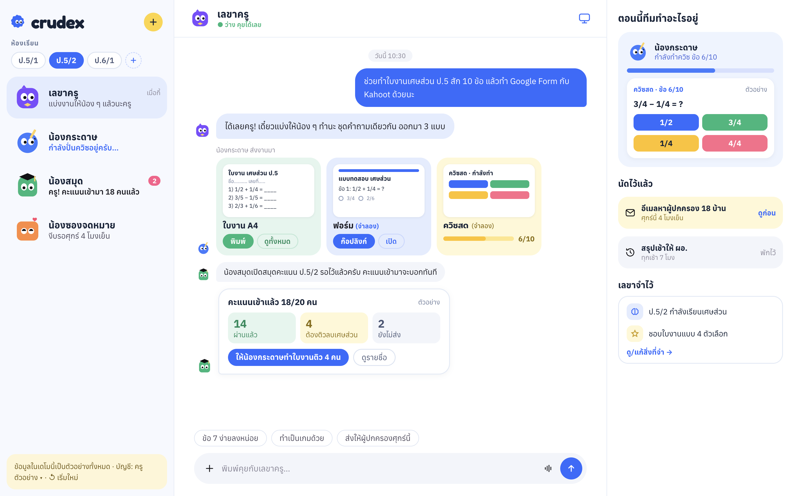
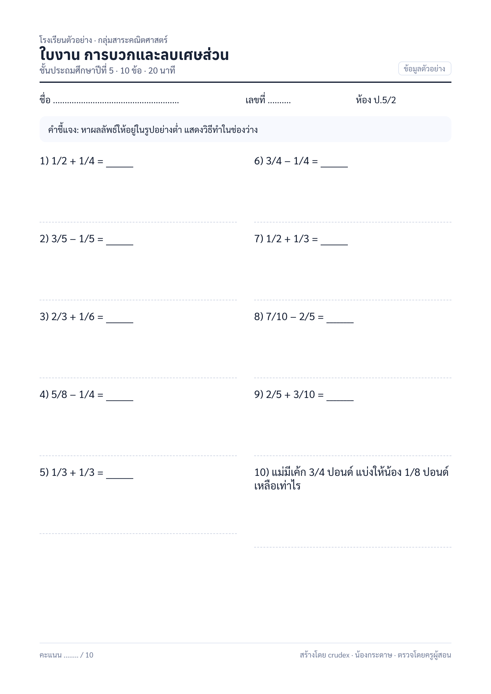

# Screen designs

The Paper screens use synthetic school data. Follow a teacher from a delegated chat to the printed worksheet, then open a screen in the inventory to inspect the full export.

## Teacher worksheet workflow

## Screen inventory

| ไฟล์ | หน้า |
|---|---|
| [00-landing.png](https://github.com/Chokchai-Fa/crudex/blob/main/docs/design/pages/00-landing.png) | Landing (desktop) |
| [00m-landing-mobile.png](https://github.com/Chokchai-Fa/crudex/blob/main/docs/design/pages/00m-landing-mobile.png) | Landing (mobile) |
| [01a-chat-done.png](https://github.com/Chokchai-Fa/crudex/blob/main/docs/design/pages/01a-chat-done.png) | แชต — ตอบเสร็จ |
| [01b-chat-streaming.png](https://github.com/Chokchai-Fa/crudex/blob/main/docs/design/pages/01b-chat-streaming.png) | แชต — กำลังตอบ |
| [01c-chat-fallback.png](https://github.com/Chokchai-Fa/crudex/blob/main/docs/design/pages/01c-chat-fallback.png) | แชต — fallback |
| [02-worksheet-a4.png](https://github.com/Chokchai-Fa/crudex/blob/main/docs/design/pages/02-worksheet-a4.png) | ใบงาน A4 |
| [03-gradebook.png](https://github.com/Chokchai-Fa/crudex/blob/main/docs/design/pages/03-gradebook.png) | สมุดคะแนน |
| [04-quiz-student-mobile.png](https://github.com/Chokchai-Fa/crudex/blob/main/docs/design/pages/04-quiz-student-mobile.png) | แบบทดสอบฝั่งนักเรียน (mobile) |
| [05-07-form-fallback-and-parent-email.png](https://github.com/Chokchai-Fa/crudex/blob/main/docs/design/pages/05-07-form-fallback-and-parent-email.png) | ฟอร์ม fallback + อีเมลผู้ปกครอง |
| [06-routines.png](https://github.com/Chokchai-Fa/crudex/blob/main/docs/design/pages/06-routines.png) | งานอัตโนมัติ (routines) |
| [08-role-select.png](https://github.com/Chokchai-Fa/crudex/blob/main/docs/design/pages/08-role-select.png) | เลือกบทบาท |
| [09-principal-brief.png](https://github.com/Chokchai-Fa/crudex/blob/main/docs/design/pages/09-principal-brief.png) | สรุปสำหรับ ผอ. |
| [10-states-components.png](https://github.com/Chokchai-Fa/crudex/blob/main/docs/design/pages/10-states-components.png) | states และ components |
| [11-app-mobile.png](https://github.com/Chokchai-Fa/crudex/blob/main/docs/design/pages/11-app-mobile.png) | แอป (mobile) |

[Paper design and JSX exports](https://github.com/Chokchai-Fa/crudex/blob/main/docs/design/paper-export/README.md)
