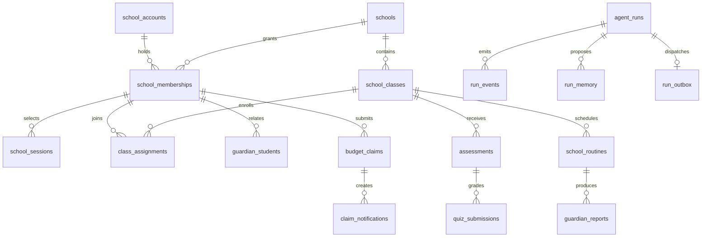

# School database schema

Neon Postgres owns school identities, runs, saved work, grades and reporting records. Drizzle uses the Neon HTTP driver in the Worker. Local development uses Postgres through a Neon-compatible proxy. The agent sandbox has a separate disposable SQLite database for OpenCode sessions. The gateway’s Durable Objects store demo state and sandbox lifecycle metadata. Those stores contain no canonical school grades or membership records.

## Read the relationships

A school account identifies a person. A membership gives that account a role in one school. An account can have multiple memberships; a school session selects one. A class assignment connects a teacher or student membership to a class. A guardian relationship connects two memberships in the same school. `owner_id` refers to the account, while `teacher_id`, `student_id`, `guardian_id` and `decided_by` in school business tables refer to memberships.

## Data dictionary

Each field table lists the PostgreSQL type, nullability and database default. A dash in the default column means no explicit default. Primary keys, foreign keys and unique constraints are listed explicitly. Some associations, such as the run ID saved with a worksheet, are checked at the service boundary. See the [schema definitions](https://github.com/Chokchai-Fa/crudex/blob/main/apps/api/src/db/schema) and [versioned SQL migrations](https://github.com/Chokchai-Fa/crudex/blob/main/apps/api/drizzle).

### Identity and school scope

#### `schools`

Tenant boundary.

| Field | PostgreSQL type | Nullable | Default | Meaning |
| --- | --- | --- | --- | --- |
| `id` | `uuid` | No | `gen_random_uuid()` | Identifier for this record. |
| `name` | `text` | No | — | Display name. |

PK (id).

#### `school_accounts`

Stable account identity.

| Field | PostgreSQL type | Nullable | Default | Meaning |
| --- | --- | --- | --- | --- |
| `id` | `uuid` | No | `gen_random_uuid()` | Identifier for this record. |
| `display_name` | `text` | No | — | Name displayed for this account. |

PK (id).

#### `school_memberships`

School role with optional expiry.

| Field | PostgreSQL type | Nullable | Default | Meaning |
| --- | --- | --- | --- | --- |
| `id` | `uuid` | No | `gen_random_uuid()` | Identifier for this record. |
| `school_id` | `uuid` | No | — | School that owns this record. |
| `owner_id` | `uuid` | No | — | Account that owns this record. |
| `role` | `school_role` | No | — | Membership role: teacher, principal, student or guardian. |
| `expires_at` | `timestamp with time zone` | Yes | — | Optional membership expiry. NULL means no scheduled expiry. |

PK (id) · Unique (school_id, id) · Unique (school_id, owner_id, role) · school_id → schools(id) · owner_id → school_accounts(id).

#### `school_classes`

Named class owned by a school.

| Field | PostgreSQL type | Nullable | Default | Meaning |
| --- | --- | --- | --- | --- |
| `id` | `uuid` | No | `gen_random_uuid()` | Identifier for this record. |
| `school_id` | `uuid` | No | — | School that owns this record. |
| `name` | `text` | No | — | Display name. |

PK (id) · Unique (school_id, id) · school_id → schools(id).

#### `class_assignments`

Class access for an assigned staff member or student.

| Field | PostgreSQL type | Nullable | Default | Meaning |
| --- | --- | --- | --- | --- |
| `school_id` | `uuid` | No | — | School that owns this record. |
| `membership_id` | `uuid` | No | — | School membership in scope. |
| `class_id` | `uuid` | No | — | Classroom in scope. |

PK (membership_id, class_id) · school_id, membership_id → school_memberships(school_id, id) · school_id, class_id → school_classes(school_id, id).

#### `guardian_students`

Current per-child access for a guardian.

| Field | PostgreSQL type | Nullable | Default | Meaning |
| --- | --- | --- | --- | --- |
| `school_id` | `uuid` | No | — | School that owns this record. |
| `guardian_membership_id` | `uuid` | No | — | Membership of the linked guardian. |
| `student_membership_id` | `uuid` | No | — | Membership of the linked student. |

PK (guardian_membership_id, student_membership_id) · school_id, guardian_membership_id → school_memberships(school_id, id) · school_id, student_membership_id → school_memberships(school_id, id).

#### `school_invitations`

Hashed, expiring single-use sign-in credential.

| Field | PostgreSQL type | Nullable | Default | Meaning |
| --- | --- | --- | --- | --- |
| `digest` | `text` | No | — | Digest of the single-use invitation token. |
| `membership_id` | `uuid` | No | — | School membership in scope. |
| `expires_at` | `timestamp with time zone` | No | — | Instant when authorization expires. |

PK (digest) · membership_id → school_memberships(id).

#### `school_sessions`

Hashed session token and selected membership.

| Field | PostgreSQL type | Nullable | Default | Meaning |
| --- | --- | --- | --- | --- |
| `digest` | `text` | No | — | Digest of the browser session token. |
| `membership_id` | `uuid` | No | — | Currently selected membership for this session. |
| `expires_at` | `timestamp with time zone` | No | — | Instant when authorization expires. |

PK (digest) · membership_id → school_memberships(id).

#### `platform_admins`

Each row grants platform-wide school administration to a dedicated account. Operators manage grants directly in Postgres. The API checks the grant on each admin request.

| Field | PostgreSQL type | Nullable | Default | Meaning |
| --- | --- | --- | --- | --- |
| `account_id` | `uuid` | No | — | School account permitted to administer schools and enroll members across the platform. |

PK (account_id) · account_id → school_accounts(id).

### Agent execution

#### `agent_runs`

Logical user request, accepted role and current execution lease.

| Field | PostgreSQL type | Nullable | Default | Meaning |
| --- | --- | --- | --- | --- |
| `id` | `uuid` | No | — | Identifier for this record. |
| `school_id` | `uuid` | No | — | School that owns this record. |
| `owner_id` | `uuid` | No | — | Account that owns this record. |
| `membership_id` | `uuid` | No | — | School membership in scope. |
| `role` | `text` | No | — | Role captured at run acceptance. |
| `agent_id` | `text` | No | — | Selected school assistant. |
| `class_id` | `uuid` | Yes | — | Optional classroom scope of the run. |
| `request_id` | `uuid` | No | — | Client-generated idempotency key for the run. |
| `prompt` | `text` | No | — | User input accepted for this run. |
| `status` | `text` | No | `'queued'` | Run state: queued, running, succeeded, failed, interrupted or cancelled. |
| `attempt_id` | `uuid` | Yes | — | Identifier of the claimed execution attempt. |
| `credential_hash` | `text` | Yes | — | Digest of the active attempt credential. |
| `lease_until` | `timestamp with time zone` | Yes | — | Deadline for the current execution attempt. |
| `created_at` | `timestamp with time zone` | No | `now()` | Time the record was created. |

PK (id) · Unique (school_id, owner_id, request_id) · Index (school_id, owner_id, agent_id, created_at).

#### `run_outbox`

Durable dispatch intent consumed when a run is claimed.

| Field | PostgreSQL type | Nullable | Default | Meaning |
| --- | --- | --- | --- | --- |
| `run_id` | `uuid` | No | — | Agent run associated with this record. |

PK (run_id) · run_id → agent_runs(id).

#### `run_events`

Committed JSON events ordered by serial cursor. Gaps in IDs across runs are normal.

| Field | PostgreSQL type | Nullable | Default | Meaning |
| --- | --- | --- | --- | --- |
| `id` | `serial` | No | Sequence | Sequence-generated cursor used for event replay. |
| `run_id` | `uuid` | No | — | Agent run associated with this record. |
| `body` | `jsonb` | No | — | Persisted run event payload consumed by the event stream. |

PK (id) · Index (run_id, id) · run_id → agent_runs(id).

#### `run_quota`

Global reservations by Bangkok calendar day.

| Field | PostgreSQL type | Nullable | Default | Meaning |
| --- | --- | --- | --- | --- |
| `day` | `date` | No | — | Bangkok calendar date used for quota accounting. |
| `used` | `integer` | No | — | Number of run reservations consumed. |

PK (day) · Check `"run_quota"."used" <= 60`.

#### `owner_run_quota`

Per-account reservations for the same day.

| Field | PostgreSQL type | Nullable | Default | Meaning |
| --- | --- | --- | --- | --- |
| `day` | `date` | No | — | Bangkok calendar date used for quota accounting. |
| `owner_id` | `uuid` | No | — | Account that owns this record. |
| `used` | `integer` | No | — | Number of run reservations consumed. |

Unique (day, owner_id) · Check `"owner_run_quota"."used"<=20`.

#### `run_memory`

Pending proposal until approved_at is set; retrieval is school- and owner-scoped.

| Field | PostgreSQL type | Nullable | Default | Meaning |
| --- | --- | --- | --- | --- |
| `id` | `uuid` | No | `gen_random_uuid()` | Identifier for this record. |
| `school_id` | `uuid` | No | — | School that owns this record. |
| `owner_id` | `uuid` | No | — | Account that owns this record. |
| `run_id` | `uuid` | No | — | Agent run associated with this record. |
| `text` | `text` | No | — | Memory content proposed for this owner. |
| `approved_at` | `timestamp with time zone` | Yes | — | Time of owner approval. NULL while proposed. |

PK (id) · Unique (run_id, text) · Index (school_id, owner_id) · run_id → agent_runs(id).

### Classroom and family reporting

#### `assessments`

Immutable worksheet content, question and option ordering, verified key and play token.

| Field | PostgreSQL type | Nullable | Default | Meaning |
| --- | --- | --- | --- | --- |
| `id` | `uuid` | No | `gen_random_uuid()` | Identifier for this record. |
| `play_token` | `uuid` | No | `gen_random_uuid()` | Token used to locate the worksheet for a quiz. |
| `school_id` | `uuid` | No | — | School that owns this record. |
| `class_id` | `uuid` | No | — | Classroom in scope. |
| `run_id` | `uuid` | No | — | Agent run associated with this record. |
| `invocation_id` | `text` | No | — | Tool invocation key used to deduplicate worksheet saves. |
| `content` | `jsonb` | No | — | Verified worksheet, ordered choices and answer key. |
| `created_at` | `timestamp with time zone` | No | `now()` | Time the record was created. |

PK (id) · Unique (play_token) · Unique (run_id, invocation_id) · Index (school_id, class_id) · school_id → schools(id) · school_id, class_id → school_classes(school_id, id).

#### `quiz_submissions`

One answer map and scored result for a student and assessment.

| Field | PostgreSQL type | Nullable | Default | Meaning |
| --- | --- | --- | --- | --- |
| `id` | `uuid` | No | `gen_random_uuid()` | Identifier for this record. |
| `assessment_id` | `uuid` | No | — | Saved worksheet used for grading. |
| `student_id` | `uuid` | No | — | Student membership. |
| `answers` | `jsonb` | No | — | Map from question IDs to submitted choice IDs. |
| `score` | `integer` | No | — | Points earned on this submission. |
| `max_score` | `integer` | No | — | Maximum possible points on this submission. |
| `created_at` | `timestamp with time zone` | No | `now()` | Time the record was created. |

PK (id) · Unique (assessment_id, student_id) · assessment_id → assessments(id) · student_id → school_memberships(id).

#### `school_routines`

Teacher-owned daily report schedule with the next due instant.

| Field | PostgreSQL type | Nullable | Default | Meaning |
| --- | --- | --- | --- | --- |
| `id` | `uuid` | No | `gen_random_uuid()` | Identifier for this record. |
| `school_id` | `uuid` | No | — | School that owns this record. |
| `class_id` | `uuid` | No | — | Classroom in scope. |
| `teacher_id` | `uuid` | No | — | Teacher membership responsible for this record. |
| `hour` | `integer` | No | — | Scheduled hour in Bangkok local time. |
| `minute` | `integer` | No | — | Scheduled minute within the hour. |
| `enabled` | `boolean` | No | `true` | Whether the scheduler may process this routine. |
| `next_run_at` | `timestamp with time zone` | No | — | Next scheduled occurrence as an absolute instant. |

PK (id) · Unique (teacher_id, class_id, hour, minute) · Index (enabled, next_run_at) · teacher_id → school_memberships(id) · school_id, class_id → school_classes(school_id, id).

#### `guardian_reports`

A per-recipient report snapshot, initially a draft.

| Field | PostgreSQL type | Nullable | Default | Meaning |
| --- | --- | --- | --- | --- |
| `id` | `uuid` | No | `gen_random_uuid()` | Identifier for this record. |
| `routine_id` | `uuid` | No | — | Daily routine that produced the report. |
| `occurrence` | `timestamp with time zone` | No | — | Scheduled instant used to deduplicate this report. |
| `student_id` | `uuid` | No | — | Student membership. |
| `guardian_id` | `uuid` | No | — | Guardian membership receiving the report. |
| `student_name` | `text` | No | — | Student display name captured at report generation. |
| `subject` | `text` | No | — | Report subject line. |
| `body` | `text` | No | — | Generated report text for this student and occurrence. |
| `status` | `text` | No | `'draft'` | Delivery state. New reports are drafts; guardians can read sent reports. |
| `created_at` | `timestamp with time zone` | No | `now()` | Time the record was created. |

PK (id) · Unique (routine_id, occurrence, student_id, guardian_id) · routine_id → school_routines(id) · student_id → school_memberships(id) · guardian_id → school_memberships(id).

### Approval desk

#### `budget_claims`

Teacher request, immutable submitted line items and a principal decision.

| Field | PostgreSQL type | Nullable | Default | Meaning |
| --- | --- | --- | --- | --- |
| `id` | `uuid` | No | `gen_random_uuid()` | Identifier for this record. |
| `school_id` | `uuid` | No | — | School that owns this record. |
| `teacher_id` | `uuid` | No | — | Teacher membership responsible for this record. |
| `client_request_id` | `uuid` | No | — | Teacher-supplied idempotency key for claim submission. |
| `date` | `date` | No | — | Claim date supplied by the teacher. |
| `budget_code` | `text` | No | — | Budget category code supplied on the claim. |
| `purpose` | `text` | No | — | Reason for the requested expense. |
| `items` | `jsonb` | No | — | Submitted line items with names, quantities and unit prices in satang. |
| `status` | `claim_status` | No | `'pending'` | Decision state: pending, approved or returned. |
| `decided_by` | `uuid` | Yes | — | Principal membership that recorded the decision. |
| `reason` | `text` | Yes | — | Decision reason, required by the API for a returned claim. |
| `decided_at` | `timestamp with time zone` | Yes | — | Time the principal recorded the decision. |
| `submitted_at` | `timestamp with time zone` | No | `now()` | Time the claim was submitted. |

PK (id) · Unique (teacher_id, client_request_id) · Index (school_id, status, submitted_at) · Index (teacher_id, submitted_at) · school_id, teacher_id → school_memberships(school_id, id) · school_id, decided_by → school_memberships(school_id, id).

#### `claim_notifications`

One notification per decision channel.

| Field | PostgreSQL type | Nullable | Default | Meaning |
| --- | --- | --- | --- | --- |
| `id` | `uuid` | No | `gen_random_uuid()` | Identifier for this record. |
| `claim_id` | `uuid` | No | — | Claim whose decision triggered the notification. |
| `channel` | `claim_channel` | No | — | Recipient channel: teacher or budget_assistant. |

PK (id) · Unique (claim_id, channel) · claim_id → budget_claims(id).

### Template records

#### `notes`

Existing example feature; independent of school identity.

| Field | PostgreSQL type | Nullable | Default | Meaning |
| --- | --- | --- | --- | --- |
| `id` | `uuid` | No | `gen_random_uuid()` | Identifier for this record. |
| `title` | `text` | No | — | Note title. |
| `body` | `text` | Yes | — | Optional note text. |
| `created_at` | `timestamp with time zone` | No | `now()` | Time the record was created. |

PK (id) · Index (created_at).

## Transaction and retention behavior

- Sign-in deletes a valid invitation and creates the session in one statement. Only token digests are stored. Expiring or revoking membership prevents further access.
- Accepting a new run reserves both quotas, writes the initial event and inserts its dispatch intent together. A repeated client request ID resolves to the original run. The active attempt credential becomes unusable after expiry or a terminal transition.
- The worksheet key belongs in teacher-authorized responses only. Each student submission is tied to the saved worksheet and can be retried with the same answers. Business records survive sandbox replacement.
- Processing a due routine advances its next occurrence and inserts guardian drafts atomically. The occurrence and recipient uniqueness rule handles queue redelivery.
- A claim decision updates a pending claim and writes its notifications in a single SQL statement. Prices are integer satang. Claim items and submitted answers are JSONB because each is retained as one immutable submission.
- The schema currently has no automatic deletion policy for historical school records. Session and invitation expiry controls authorization; expiry alone does not physically purge rows.

For local schema changes, use `pnpm --filter api db:generate`, inspect the SQL and snapshot, then run `pnpm --filter api db:migrate` against a disposable local database. Production migrations must be additive while the prior Worker revision can still serve requests. [API contract](../integrations/school-api.md)
